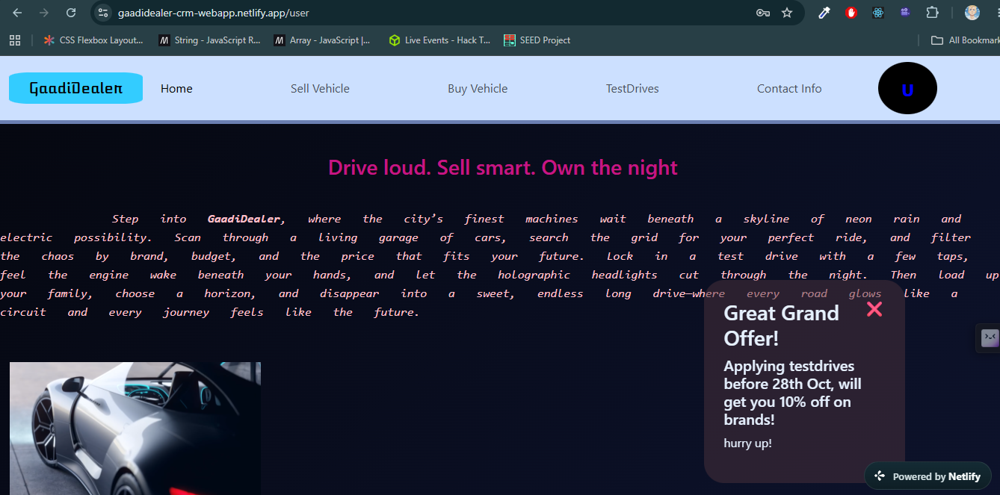
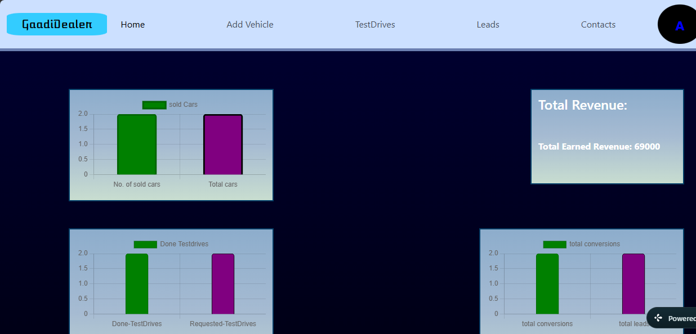
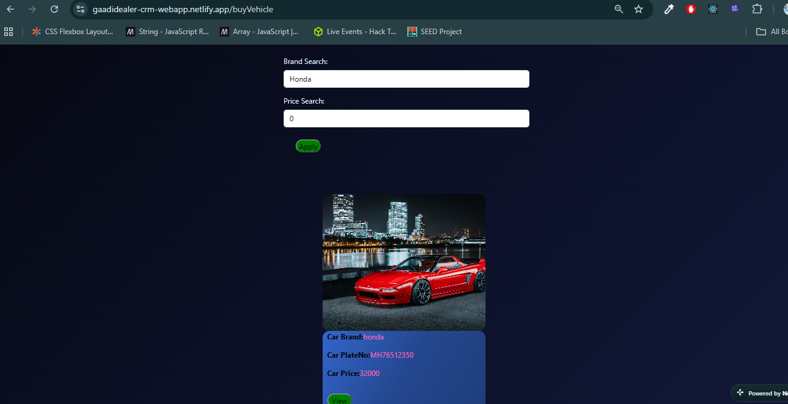
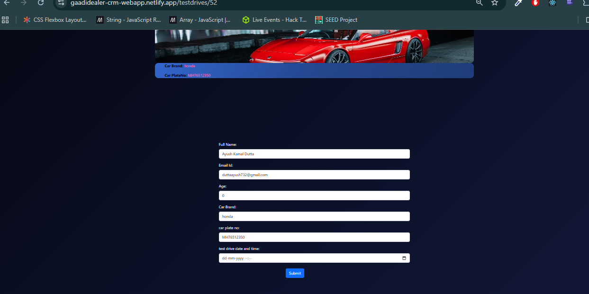
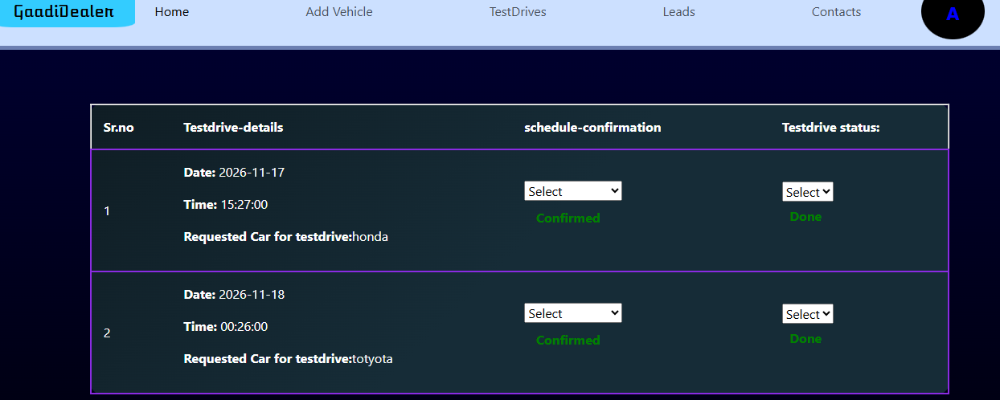
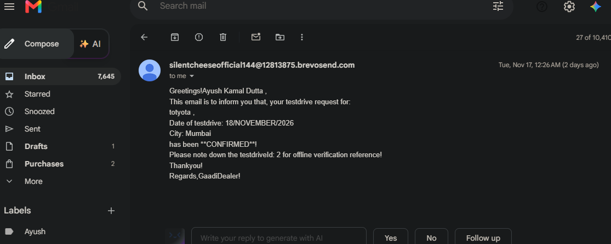
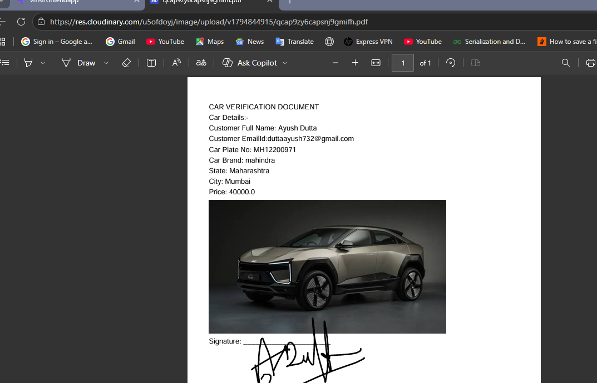

# GaadiDealer-CRM 🚗

A full-stack Vehicle Management and Customer Relationship Management (CRM) application built using **Spring Boot, React, and MySQL**. The application provides vehicle management, customer lead tracking, contact management, test-drive scheduling, and integrated payment processing through a role-oriented interface for administrators and users.

## 🌐 Live Application

| Component | Deployment |
|---|---|
| Frontend | [Netlify Deployment](https://gaadidealer-crm-webapp.netlify.app/) |
| Backend | [Render Deployment](https://gaadidealer-crm.onrender.com) |
| Database | TiDB Cloud |

## 📌 Project Overview

GaadiDealer-CRM is designed to streamline vehicle dealership operations by bringing vehicle management and customer relationship workflows into a single application.

The application provides separate dashboards for administrators and users, allowing them to access relevant functionalities according to their roles.

It follows a layered backend architecture using Spring Boot and a component-based frontend architecture using React.

## ✨ Key Features

### 🔐 Authentication and Authorization
- User registration and login.
- JWT-based authentication.
- Cookie-based authentication mechanism.
- Spring Security integration.
- Protected frontend routes.
- Separate administrator and user dashboards.

### 🚘 Vehicle Management
- Add vehicles to the system.
- View available vehicles.
- Search and explore vehicle listings.
- View individual vehicle details.
- Vehicle buying and selling workflows.
- Vehicle image handling using Cloudinary integration.

### 👥 Customer Relationship Management
- Lead management.
- Contact management.
- Customer-related information handling.
- Dedicated lead and contact modules.

### 🚗 Test Drive Management
- Test-drive workflows associated with vehicles.
- Test-drive information management.
- Separate test-drive views for administrators and users.

### 💳 Payment Integration
- Razorpay payment gateway integration.
- Payment order creation.
- Payment verification using Razorpay signatures.
- Checkout workflow associated with test-drive records.

### 📧 Email Integration
- Email functionality using Spring Boot Mail.
- SMTP integration with Brevo.

### 📊 Data Visualization
- Chart-based data visualization using Chart.js and React Chart.js.

## 🛠️ Technology Stack

### Backend

| Technology | Purpose |
|---|---|
| Java 21 | Programming language |
| Spring Boot 4.0.8 | Backend framework |
| Spring WebMVC | REST API development |
| Spring Security | Application security |
| Spring Data JPA | Database interaction |
| Hibernate | ORM |
| MySQL Connector/J | Database connectivity |
| JJWT 0.13.0 | JWT implementation |
| Maven | Dependency management |
| Lombok | Boilerplate reduction |

### Frontend

| Technology | Purpose |
|---|---|
| React 19.2.8 | UI development |
| Vite 8.3.0 | Development and build tooling |
| React Router DOM 7.18.4 | Client-side routing |
| Axios 1.20.0 | HTTP communication |
| Bootstrap 5.3.8 | UI styling |
| Chart.js 4.6.1 | Data visualization |
| React Chart.js 2 | React chart integration |
| Razorpay SDK 2.9.8 | Payment integration |

### Database and External Services

- **MySQL / TiDB Cloud:** Relational database.
- **Cloudinary:** Cloud-based media storage.
- **Razorpay:** Payment gateway.
- **Brevo:** SMTP email service.

### Deployment

- **Render:** Backend hosting.
- **Netlify:** Frontend hosting.
- **TiDB Cloud:** Managed database.

## 🏗️ System Architecture

The application follows a layered architecture on the backend and a component-based architecture on the frontend.

```text
                 React Frontend
                  (Netlify)
                      |
                      |
                Axios Requests
                Cookie Credentials
                      |
                      v
              Spring Boot Backend
                  (Render)
                      |
          +-----------+-----------+
          |           |           |
          v           v           v
      Controllers  Security    Services
          |        (JWT)          |
          |                       |
          +-----------+-----------+
                      |
                      v
                  Repositories
                      |
                      v
                Hibernate / JPA
                      |
                      v
                MySQL / TiDB
```

### Backend Architecture

The backend follows separation of concerns through dedicated packages.

```text
GaadiDealer/
│
├── src/main/java/com/MarketConnect/GaadiDealer/
│   │
│   ├── classconversions/
│   │   └── ClassConversion.java
│   │
│   ├── configs/
│   │   ├── CloudinaryConfig.java
│   │   ├── CorsConfig.java
│   │   └── SecurityConfig.java
│   │
│   ├── controllers/
│   │   ├── AuthController.java
│   │   ├── CarController.java
│   │   ├── ContactsController.java
│   │   ├── EmailController.java
│   │   ├── LeadsController.java
│   │   ├── PaymentController.java
│   │   ├── TestDriveController.java
│   │   └── UserController.java
│   │
│   ├── dtos/
│   │
│   ├── entities/
│   │
│   ├── exception/
│   │
│   ├── repositories/
│   │
│   ├── services/
│   │
│   └── GaadiDealerApplication.java
│
└── src/main/resources/
    ├── static/
    ├── templates/
    ├── uploads/
    └── application.properties
```

### Frontend Architecture

```text
GaadiDealerFrontend/
│
├── package.json
│
└── vmsfrontendapp/
    │
    └── src/
        ├── assets/
        │
        ├── components/
        │   ├── AddVehicle
        │   ├── BuyVehicle
        │   ├── Contacts
        │   ├── Home
        │   ├── HomeAdmin
        │   ├── HomeUser
        │   ├── Leads
        │   ├── Login
        │   ├── Payment
        │   ├── ProtectedRoute
        │   ├── Register
        │   ├── SellVehicle
        │   ├── TestDrives
        │   ├── ViewACar
        │   ├── ViewCars
        │   ├── ViewTestDrives
        │   └── ViewTestDrivesAdmin
        │
        ├── App.jsx
        ├── App.css
        ├── axiosConfig.js
        ├── index.css
        └── main.jsx
```

## 🔒 Authentication and Security

The application uses Spring Security and JSON Web Tokens (JWT) for authentication.

The backend contains dedicated security components:

- `SecurityConfig` – Configures Spring Security.
- `JwtService` – Handles JWT generation and validation.
- `JwtFilter` – Processes incoming requests for JWT authentication.
- `MyUserDetailsService` – Loads user details for Spring Security.
- `AuthService` – Handles authentication-related business logic.

### Frontend Authentication Flow

The React application uses a centralized Axios instance with `withCredentials: true` to support cookie-based authentication.

Protected routes communicate with the backend `/me` endpoint to verify the current authentication state before rendering protected components.

## 💾 Database Design

The backend uses Spring Data JPA and Hibernate for relational database operations.

The main entity classes include:

| Entity | Description |
|---|---|
| User | User information |
| UserType | User types and roles |
| Vehicle | Vehicle information |
| Leads | Customer lead information |
| Contacts | Contact information |
| TestDrive | Test-drive records |
| Status | Status information |

DTOs are used to transfer data between application layers, while `ClassConversion` handles entity-to-DTO and DTO-to-entity conversions.

## 💳 Payment Processing

The application integrates Razorpay for payment processing.

The backend uses the Razorpay Java SDK, while the frontend includes the Razorpay SDK dependency.

The payment workflow includes:
1. Creating a payment order.
2. Initiating the payment process.
3. Receiving payment details.
4. Verifying payment signatures on the backend.
5. Processing the verification result.


  
## Screenshots

### User Page


### Admin Dashboard


### Vehicle Searching


### Submitting form for testdrive request to admin


### Admin confirming testdrive


### Email Notification for testdrive confirmation


### Deal Document verification by Admin


### Contacts section for admin...to advertise them and target in future for more deals conversions!


## 📁 Exception Handling

The backend implements centralized exception handling through:

- `GlobalExceptionHandler`
- `ErrorResponse`
- `DuplicateEmailException`

This helps maintain consistent error handling across backend operations.

## ⚙️ Installation and Setup

### Prerequisites

Make sure the following are installed:

- Java 21
- Maven
- Node.js and npm
- MySQL-compatible database
- Git

External service accounts are required for the integrations you intend to use.

### 1. Clone the Repository

```bash
git clone https://github.com/AyushKDutta271/GaadiDealer-CRM.git
cd GaadiDealer-CRM
```

### 2. Backend Setup

Navigate to the backend directory:

```bash
cd GaadiDealer
```

Configure the required environment variables.

Start the backend:

```bash
mvn spring-boot:run
```
OR jus click on Run

The backend runs on port `8080` by default.

### 3. Frontend Setup

Open another terminal and navigate to:

```bash
cd GaadiDealerFrontend/vmsfrontendapp
```

Install dependencies:

```bash
npm install
```

Create a `.env` file in the frontend application directory:

```env
VITE_API_BASE_URL=http://localhost:8080
```

Start the development server:

```bash
npm run dev
```

Vite will display the local frontend URL in the terminal.

## 🔑 Environment Variables

### Backend Configuration

Configure the following environment variables before starting the backend:

| Variable | Description |
|---|---|
| `PORT` | Backend server port |
| `DB_URL` | Database JDBC connection URL |
| `DB_USERNAME` | Database username |
| `DB_PWD` | Database password |
| `JWT_SECRET` | JWT signing secret |
| `RAZORPAY_API_KEY` | Razorpay API key |
| `RAZORPAY_SECRET_KEY` | Razorpay secret key |
| `MailUserName` | SMTP username |
| `MailUserPassword` | SMTP password |

Cloudinary credentials must also be configured according to `CloudinaryConfig`.

### Frontend Configuration

| Variable | Description |
|---|---|
| `VITE_API_BASE_URL` | Backend API base URL |

**Security Note:** Never commit actual API keys, database credentials, JWT secrets, or SMTP passwords to GitHub. Use environment variables and keep `.env` files out of version control.

## 🚀 Deployment

The application is deployed using separate hosting platforms for the frontend and backend.

| Component | Platform |
|---|---|
| React frontend | Netlify |
| Spring Boot backend | Render |
| Database | TiDB Cloud |
| Image storage | Cloudinary |

The frontend communicates with the deployed backend through the `VITE_API_BASE_URL` environment variable.

The backend uses environment-based configuration for its database, authentication, payment, and email credentials.

## 🔮 Future Improvements

- Enhanced CRM reporting and analytics.
- Advanced vehicle search and filtering.
- Improved customer relationship tracking.
- Additional dashboard insights.
- Further improvements to application security and performance.

## 👨‍💻 Author

**Ayush Kamal Dutta**

Full-Stack Developer

GitHub: [AyushKDutta271](https://github.com/AyushKDutta271)

LinkedIn: [Ayush Kamal Dutta](www.linkedin.com/in/ayush-kamal-dutta-172a203a4)

---

*GaadiDealer-CRM — Bringing vehicle management and customer relationship workflows together in one application.*
